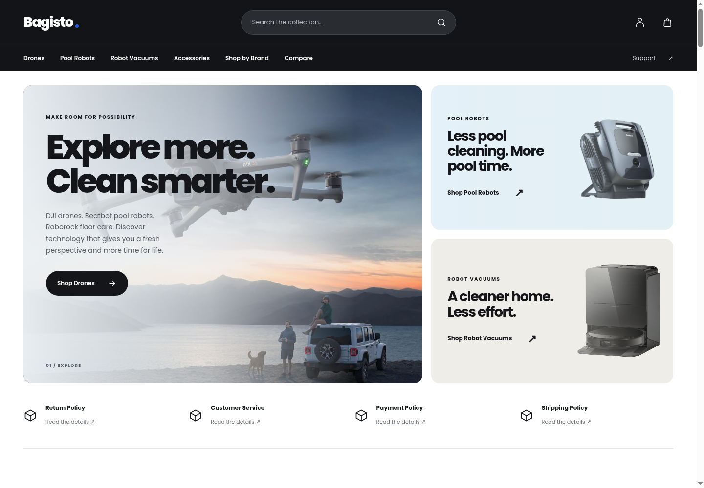

# MX Technology — Bagisto Theme

A Composer-installable technology storefront for **Bagisto 2.5.x**, with drone, pool-robot and robot-vacuum collections. It builds on Bagisto's default Shop theme and reuses its Vue application, native product cards, search, mini-cart, wishlist, comparison tools, accounts and checkout.

**Installing the theme does not create or delete products, change prices, rewrite store policies or enable a payment gateway.** An optional, explicit catalog importer is provided separately.

## Preview

Example storefront using the optional DJI, Beatbot and Roborock catalog:



[Mobile preview](docs/screenshots/mobile.png)

## Compatibility

| Component | Supported |
| --- | --- |
| Bagisto | 2.5.x; tested against 2.5.x-dev |
| PHP | 8.4 or 8.5 |
| Laravel | 13.x |
| Frontend | Existing default Shop production build |

This package is an extension for an existing Bagisto application. Compatibility with earlier Bagisto/Laravel releases is not claimed. No separate npm build or new JavaScript dependency is required. Existing payment gateways, including NOWPayments, continue to use Bagisto's native checkout.

## Install with Composer

Until this package is submitted to Packagist, add its VCS repository in your Bagisto application:

```bash
composer config repositories.mx-technology vcs https://github.com/muz9555/bagisto-theme
composer require muz9555/bagisto-theme:^1.0
php artisan mx-theme:install --activate --channel=default
```

Laravel discovery registers the theme and its commands. No edits to `bootstrap/providers.php`, `config/concord.php`, `config/themes.php` or root PSR-4 mappings are needed.

The installer publishes assets to `public/themes/shop/mx-technology`, creates `config/mx-technology.php` only when absent, and activates the theme only when `--activate` is supplied. For a different channel, provide its existing channel code. It preserves the channel's name, logo, favicon, locales, currencies and inventory sources. Repeating installation refreshes package assets and retains merchant configuration.

To install assets without changing the selected theme:

```bash
php artisan mx-theme:install
```

You can also select **MX Technology** in Admin → Settings → Channels.

### Shop assets and media

The default Shop build must already exist at the build directory configured in `themes.shop.default.vite.build_directory`. For a source checkout that has not built its Shop assets:

```bash
cd packages/Webkul/Shop
npm ci
npm run build
```

Run `php artisan storage:link` from the application root if its public media link is missing. The theme reuses the default Shop Vite configuration and native checkout views.

### Downloaded ZIP installation

Extract the release ZIP so its `composer.json` is at `packages/Webkul/MXTechnology/composer.json`, then register it as a Composer path repository:

```bash
composer config repositories.mx-technology path packages/Webkul/MXTechnology
composer require muz9555/bagisto-theme:@dev
php artisan mx-theme:install --activate --channel=default
```

Composer must register the package even when files are installed from a ZIP. Copying the files alone does not trigger package discovery.

### Upgrading the earlier local theme

If the theme was installed using the earlier root PHP installer, preserve its configuration and source first. Remove duplicate `Webkul\MXTechnology\` root Composer PSR-4 mappings and the explicit `MXTechnologyServiceProvider` entry in `bootstrap/providers.php`, then move the old source folder out of the autoload path before VCS installation. Install this Composer package and run `composer dump-autoload` followed by `php artisan mx-theme:install`.

The theme code remains `mx-technology`, so an already selected channel does not need to be renamed. The old `install-mx-technology.php` registration script is not required by this package.

## Storefront sections

- Editorial hero with one main panel and two category panels.
- Links to actual shipping, returns, payment and customer-service policies.
- Image-based category browsing and native product cards with category tabs.
- DJI, Beatbot and Roborock spotlights, backed by the configured catalog.
- Collection selection links and separate model-comparison tabs.
- Model-compatible accessories and official manufacturer demo/tutorial links.
- Approved product reviews, buying guides, policy FAQs and product advice.
- Brand introductions, newsletter form and support/policy footer.

Collections without published channel products are omitted. Empty technology collections fall back to the store's published catalog. Ratings and sale badges come from Bagisto's real product data. Default local buying-guide links are omitted until their CMS pages exist in the current channel. Optional external demo links do not autoplay; direct video files can use native video controls.

## Configure your store

Edit the published `config/mx-technology.php`:

| Setting | Purpose |
| --- | --- |
| `accent`, `announcement` | Brand color and an actual store message |
| `hero` | Homepage headline and introduction |
| `groups` | Category slugs, brand labels, images, copy and comparable attribute codes |
| `brand_details`, `guides` | Brand introductions and existing CMS page links |
| `demos`, `videos` | Official external demos or direct video files with posters |
| `contact_links`, `social_links` | Real contact and social destinations |

The included defaults target `drones`, `pool-robots` and `robot-vacuums`. Map these to your existing category slugs or deliberately import the optional example catalog. Images and internal links resolve against the application's URL, including subdirectory installations.

The homepage layout is driven by this configuration and catalog data; the default Shop drag-and-drop homepage sections do not control this custom layout.

Your channel name, logo and product data remain the source of store identity. Do not treat example manufacturer promotions, shipping promises or warranty terms as your own store policies.

### Customize Blade views

Views are loaded from the installed package using its `mx-technology` namespace, so installation under `vendor/` works without a fixed filesystem path. Native Bagisto views remain the fallback.

For editable theme overrides, publish them explicitly:

```bash
php artisan vendor:publish --tag=mx-technology-views
```

This creates `resources/themes/mx-technology/views`. Keep track of these overrides when upgrading: published views take precedence over package updates. You can also use Laravel's `resources/views/vendor/mx-technology` namespace override convention. The normal theme installer does not overwrite published view overrides.

## Optional drone and robot catalog

The optional importer contains ten products: three DJI drones, two Beatbot pool robots, two Roborock robot vacuums and three compatible accessories. It also supplies ten shopping categories, brand options, public specifications, three brand pages and three buying guides.

Preview and import only when wanted:

```bash
php artisan mx-theme:import-catalog --channel=default --dry-run
php artisan mx-theme:import-catalog --channel=default
```

The importer requires a USD base-currency channel, an inventory source and disabled backorders. Prices are the manufacturer regular/compare-at USD references reviewed on **16 November 2026**, not a live price feed. Temporary sales were excluded. All imported inventory is zero, so checkout remains unavailable until you enter your stock. Check shipping weights, dimensions and tax classification before selling imported items.

Existing SKUs, prices, inventory, images and CMS pages are preserved on repeat imports. It does not delete unrelated catalog data or globally replace other stores' brands and filters. The dedicated technology product family excludes clothing color and size fields. Specifications and image-source URLs are recorded in `src/Resources/catalog/products.json`.

The bundled product photographs are manufacturer assets. See [NOTICE](NOTICE.md); the code's MIT license does not grant rights to those images or brand names. Replace them with your own licensed media as appropriate.

## Update or switch back

```bash
composer update muz9555/bagisto-theme
php artisan mx-theme:install
```

Published configuration is preserved. Merge new defaults from `src/Config/theme.php` when upgrading. If rendered content appears stale, clear the application's response cache after deployment.

To revert, select the previous theme in channel settings. Catalog, orders and payment data remain available.

## Development

```bash
composer install
composer test
composer lint
```

Full import, URL-portability, view-fallback and installation tests require a migrated Bagisto 2.5 application with its development dependencies and a seeded USD **test database**:

```bash
BAGISTO_PATH=/absolute/path/to/bagisto composer test:bagisto
```

The suite uses database transactions, fake catalog media storage and temporary publisher destinations. It sends no payment. PHP 8.4 and 8.5 unit/style checks are configured in GitHub Actions. See [VERIFICATION.md](VERIFICATION.md) for actual validation results.

## License

Theme code: [MIT](LICENSE), copyright 2026 Sohail Muzammil. Manufacturer imagery and names are excluded; see [NOTICE](NOTICE.md).
